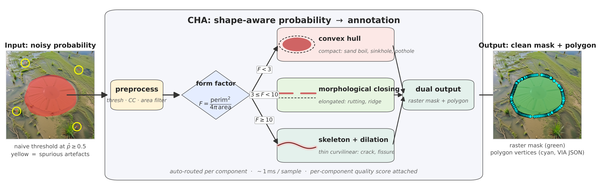

# Convex_Hull_Annotator

Shape-aware probability → annotation. Takes a sigmoid probability map
from any segmenter, emits a clean binary mask **and** a VIA-format
polygon JSON. Generalises across compact, elongated, and thin
curvilinear defects through one auto-routed pipeline.



## Install

```bash
pip install -r requirements.txt
```

Python 3.9+. Deps: numpy, scikit-image, opencv-python.

## Use

```python
from convex_hull import CHA
result = CHA.from_spec("domain_specs/rutting.json")(prob_map)
result.raster_mask                       # uint8 (H, W) 0/255
result.polygons                          # list of polygons + quality scores
result.write_via_json("out.json", "image_001.png")
```

`prob_map` is a numpy array of shape `(H, W)` or `(H, W, C)` from any
framework. End-to-end Keras example:
[`examples/keras_segmenter_example.py`](examples/keras_segmenter_example.py).

## Pipeline

1. **threshold** — Otsu by default; alternatives: `li`, `yen`, `mean`, `fixed`
2. **connected components** — 8-connectivity
3. **area filter** — reject by *fraction* of image area, `a ∈ [0.001, 0.85]` (default)
4. **shape-aware cleanup** — routed by form factor `F = perimeter²/(4π·area)`:

   | F           | policy          | typical defect           |
   |-------------|-----------------|--------------------------|
   | `F < 3`     | convex hull     | sand boil, sinkhole, pothole |
   | `3 ≤ F < 10`| closing         | rutting groove           |
   | `F ≥ 10`    | skeleton + dilation | crack                  |

5. **output** — binary raster + VIA polygons with per-component score, solidity, F

## Config

`CHAConfig` (or `domain_specs/*.json`):

| field               | default  | notes                                  |
|---------------------|----------|----------------------------------------|
| `threshold_policy`  | `otsu`   | `otsu | li | yen | mean | fixed`      |
| `min_area_frac`     | `0.001`  | reject smaller components              |
| `max_area_frac`     | `0.85`   | reject blow-ups                        |
| `shape_policy`      | `auto`   | or pin to one policy                   |
| `closing_radius`    | `3`      | px, for elongated defects              |
| `skeleton_dilate`   | `4`      | px, for cracks                         |
| `preserve_holes`    | `False`  | keep interior cavities (ring defects)  |
| `min_quality_score` | `0.0`    | drop low-mean-prob components          |

## New defect class

Write a JSON spec; run. No code changes.

```python
cha = CHA.from_spec("domain_specs/my_class.json")
```

Five canonical specs ship in [`domain_specs/`](domain_specs/).

## Self-test

```
$ python convex_hull.py
  sandboil    -> convex_hull   form=1.1   tau=0.455
  sinkhole    -> convex_hull   form=1.1   tau=0.399
  rutting     -> closing        form=5.7   tau=0.334
  crack       -> skeleton       form=17.4  tau=0.200
```

## Citation

```bibtex
@misc{thapa_chull_annotator,
  author       = {Thapa, Padam Jung},
  title        = {Convex\_Hull\_Annotator: Automated convex-hull mask annotation
                  from a SandBoilNet probability map},
  year         = {2023},
  howpublished = {\url{https://github.com/padam56/Convex_Hull_Annotator}}
}
```

[MIT](LICENSE) licensed.
